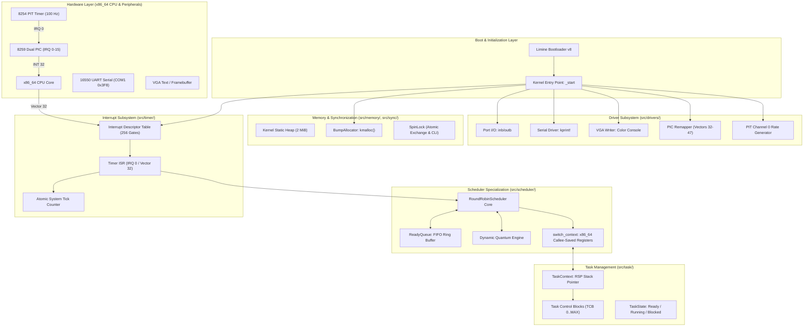
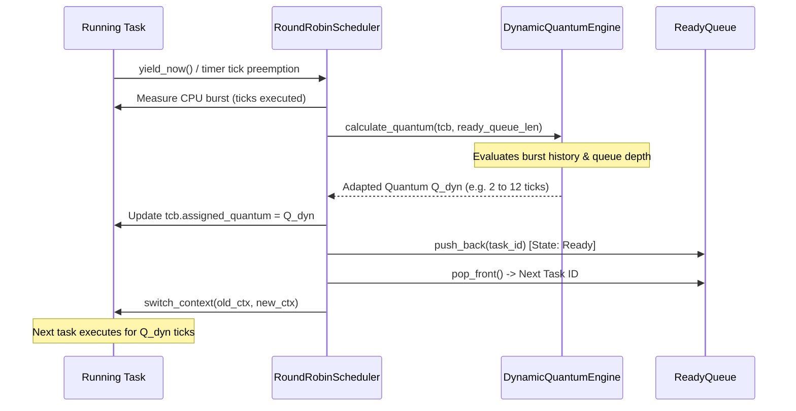

# System Architecture Documentation

**Project Name:** Mayaank N – Micro-OS  
**Student Name:** Mayaank N  
**USN:** 25BTRCL148  
**Specialization:** Scheduler Engineering – Round Robin with Dynamic Quantum  
**Target Platform:** x86_64 Bare-Metal (`no_std`, `no_main`)  
**Bootloader:** Limine Boot Protocol v8  
**Emulator:** QEMU  

---

## 1. Architectural Overview

Mayaank N – Micro-OS is an educational bare-metal operating system kernel written in safe and systems-level Rust. It implements a non-preemptive and preemptive multi-tasking microkernel architecture centered around a specialized **Round Robin Scheduler with Dynamic Quantum Adaptation**.

The kernel is structured modularly with clear separation of concerns across drivers, memory management, synchronization, task control, interrupt handling, and scheduler subsystems.

---

## 2. Subsystem Structure

The repository follows a clean, modular structure as required by the CA6 assignment:

| Subsystem Directory | Responsibilities | Key Primitives & Structures |
| :--- | :--- | :--- |
| `kernel/src/drivers/` | Hardware I/O and peripheral drivers | `inb`, `outb`, `io_wait`, `SerialPort` (COM1 0x3F8), `VgaWriter` (0xb8000), `ChainedPics` (8259 PIC), `init_pit` (8254 PIT) |
| `kernel/src/sync/` | Thread-safe mutual exclusion | `SpinLock<T>`, `SpinLockGuard<'a, T>`, `lock_irq_disabled()`, RAII drop |
| `kernel/src/memory/` | Physical heap allocation & alignment | `BumpAllocator`, `init_heap`, `kmalloc()`, `align_up`, `KERNEL_ALLOCATOR` |
| `kernel/src/task/` | Task abstractions and CPU context | `TaskId`, `TaskState`, `TaskContext` (`rsp`), `TaskControlBlock`, `DEFAULT_STACK_SIZE` (32 KiB) |
| `kernel/src/scheduler/` | Task scheduling and dynamic quantum | `ReadyQueue` (FIFO), `DynamicQuantumEngine`, `RoundRobinScheduler`, `switch_context`, `yield_now` |
| `kernel/src/timer/` | Time base and interrupt handling | `current_ticks`, `increment_ticks`, `init_idt`, `IdtEntry`, `timer_interrupt_entry` |
| `kernel/src/kernel/` | Logging, Limine protocol, telemetry | `kprintln!`, `klog_info!`, `klog_sched!`, `dump_scheduler_diagnostics`, `dump_memory_diagnostics` |

---

## 3. Data Flow and Control Flow

### 3.1 Control Flow (Task Dispatch & Context Switching)
1. **Boot Initialization:** Limine loads the ELF64 kernel at `0xffffffff80000000`, establishes 64-bit long mode, and passes control to `_start`.
2. **Device Setup:** Serial COM1 and VGA buffers are initialized. The dual 8259 PIC is remapped from default vectors to 32–47 to avoid collision with CPU exceptions.
3. **Interrupt Table:** The IDT is populated with exception handlers and the vector 32 timer ISR, referencing the active kernel CS segment (`0x28`).
4. **Task Allocation:** Kernel heap allocator assigns 32 KiB stacks for Task 1 (`Compute-Worker`), Task 2 (`Telemetry-Worker`), and Task 3 (`Burst-Worker`).
5. **Initial Dispatch:** `SCHEDULER.schedule_next()` dequeues Task 1, and `switch_context` performs the first bootstrap context switch.
6. **Execution & Yield:** Running tasks execute workloads. When a task calls `yield_now()`, its registers are pushed onto its stack, its `rsp` is saved in its TCB, the next task is dequeued, and the CPU switches stacks and pops registers.

### 3.2 Data Flow (Dynamic Quantum Feedback Loop)

